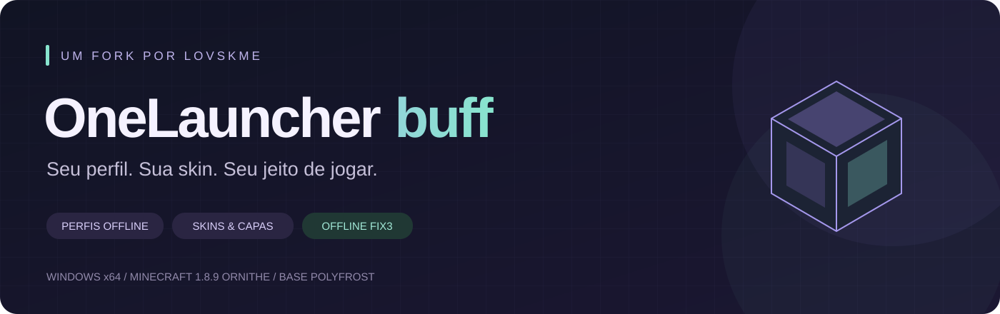

<div align="center">



# OneLauncher buff

**Seu perfil. Sua skin. Seu jeito de jogar.**

Fork independente do OneClient / OneLauncher, com perfis offline e um Wardrobe local para Minecraft 1.8.9.

[**↓ Baixar para Windows x64**](https://github.com/lovskme/OneLauncher-buff/releases/download/2.12.1-offline-fix3/OneClient-Offline-Fix3-Windows-x64-setup.exe) · [O que mudou](#o-que-mudou) · [Como usar](#começar-a-jogar) · [Guia completo](docs/GUIA.md)

**2.12.1 · Offline Fix3** &nbsp; / &nbsp; Windows x64 &nbsp; / &nbsp; Aparência local em 1.8.9 Ornithe

</div>

---

## O que é esse fork?

Esta versão adapta o launcher da [Polyfrost](https://github.com/Polyfrost/OneLauncher) para criar e usar perfis offline, importar skins e capas em PNG e manter a aparência local sincronizada entre o launcher e o jogo.

O projeto original e seus autores recebem os créditos pela base. **Este fork é independente e não é uma distribuição oficial da Polyfrost.**

## Download

| Arquivo | Para que serve |
| --- | --- |
| [**OneClient Offline Fix3 — Windows x64**](https://github.com/lovskme/OneLauncher-buff/releases/download/2.12.1-offline-fix3/OneClient-Offline-Fix3-Windows-x64-setup.exe) | Instalador com as alterações do fork |
| [Notas e arquivos da versão](https://github.com/lovskme/OneLauncher-buff/releases/tag/2.12.1-offline-fix3) | Detalhes da versão e arquivo de verificação SHA-256 |
| [Build e testes do Fix3](https://github.com/lovskme/OneLauncher-buff/actions/runs/45901138960) | Histórico da compilação que gerou esse instalador |

O instalador do fork não tem assinatura digital. A release está marcada como **pré-lançamento**, para distinguir esta distribuição independente das versões oficiais. Não há pacote customizado de macOS ou Linux nesta release.

## O que mudou?

| Área | Alteração neste fork |
| --- | --- |
| **Perfis offline** | Criação no primeiro acesso e em **Settings → Accounts → Add offline**, sem exigir uma conta Microsoft cadastrada. O primeiro perfil vira o padrão. |
| **Skins em PNG** | Importação de skins clássicas ou slim, salvas por perfil. Também é possível buscar uma skin por nome de usuário. |
| **Capas locais** | Importação e remoção de capas em PNG pelo Wardrobe. |
| **Wardrobe integrado** | Launcher e jogo compartilham os arquivos da aparência. O Wardrobe do jogo mantém a biblioteca local de skins e seus controles. |
| **Prévia e avatares** | Atualização da skin ao trocar de perfil ou textura, correção do cache e do ciclo de redesenho dos avatares. |
| **Instalação do componente** | Resolução da pasta de mods realmente usada pela instância, incluindo caminhos personalizados e layouts antigos. |
| **Fix3: jogador em partida** | A skin e a capa ficam vinculadas ao jogador ativo mesmo quando um servidor troca o UUID informado pelo perfil. |
| **Atualizações** | O instalador oficial não substitui automaticamente esta build, preservando as alterações locais. |

**Aparência local:** as skins e capas aparecem neste cliente; não são enviadas automaticamente para os outros jogadores. A conta Microsoft continua necessária para serviços e servidores que exigem autenticação. Os itens pagos do catálogo mantêm suas regras de propriedade.

## Começar a jogar

1. **Baixe e instale** o Offline Fix3 para Windows x64.
2. No primeiro acesso, digite um nome e escolha **Add offline**. Se já usa o launcher, vá a **Settings → Accounts → Add offline**.
3. Crie ou prepare uma instância **Minecraft 1.8.9 com o bundle OneClient / Ornithe**. Faça os downloads iniciais com internet.
4. Selecione o perfil offline e abra **Wardrobe**. Importe sua skin clássica/slim e, se quiser, uma capa.
5. Inicie o jogo. Você também pode mudar a aparência no Wardrobe dentro da partida.

| Arquivo | Formato aceito |
| --- | --- |
| Skin | PNG de **64 × 64** ou **64 × 32** pixels |
| Capa | PNG de **64 × 32** pixels |
| Nome offline | **3 a 16** letras ASCII, números ou sublinhado (`_`) |

A busca por nome precisa de internet; a textura baixada fica salva localmente. O componente de aparência desta build atende **1.8.9 Ornithe**; instâncias vanilla ou Forge não usam esse componente.

## Validado

- **Build Windows:** concluída, com testes de perfis offline, PNGs, avatares e instalação do componente.
- **Instalador:** instalação silenciosa e presença do executável e das bibliotecas de runtime verificadas no CI.
- **Dentro da partida:** funcionamento confirmado pelo mantenedor em **27/11/2026**. É uma confirmação de uso real, sem afirmar compatibilidade com todos os servidores e configurações.

[Ver notas detalhadas do Fix3 →](docs/RELEASE_FIX3.md)

## Código e compilação

| Branch | Conteúdo |
| --- | --- |
| [`offline-profiles`](https://github.com/lovskme/OneLauncher-buff/tree/offline-profiles) | Código dos perfis offline e Wardrobe; origem do instalador Fix3 |
| [`main`](https://github.com/lovskme/OneLauncher-buff/tree/main) | Apresentação e documentação de entrada do repositório |
| [`crewx-oneclient`](https://github.com/lovskme/OneLauncher-buff/tree/crewx-oneclient) | Trabalho separado de compatibilidade CrewX; não faz parte do instalador Offline Fix3 |

Para reproduzir a build com o componente local, use o [workflow Windows](https://github.com/lovskme/OneLauncher-buff/blob/offline-profiles/.github/workflows/offline_windows.yml). Ele compila o componente de aparência antes de embuti-lo no launcher.

```sh
git clone --branch offline-profiles https://github.com/lovskme/OneLauncher-buff.git
cd OneLauncher-buff

# Launcher sem embutir o componente local:
cargo run -p oneclient_app

# Com o componente já gerado pelo workflow:
cargo build --locked --release -p oneclient_app --features local-appearance
```

Requer **Rust 1.97 ou superior** e as dependências de desenvolvimento da plataforma. A flag `local-appearance` precisa do JAR gerado pelo workflow; o comando isolado não produz esse arquivo.

[Patch e documentação do componente →](https://github.com/lovskme/OneLauncher-buff/tree/offline-profiles/distribution/local-appearance)

## Créditos e licença

Base: **Polyfrost e contribuidores do OneClient / OneLauncher**. Componente local baseado no **PolyPlus**, com revisão e patch descritos no código do fork.

O launcher mantém a licença **GPL-3.0-only**, disponível em [LICENSE](LICENSE). O componente PolyPlus mantém sua licença e exceção de linking próprias, descritas na [documentação do componente](https://github.com/lovskme/OneLauncher-buff/blob/offline-profiles/distribution/local-appearance/README.md).
